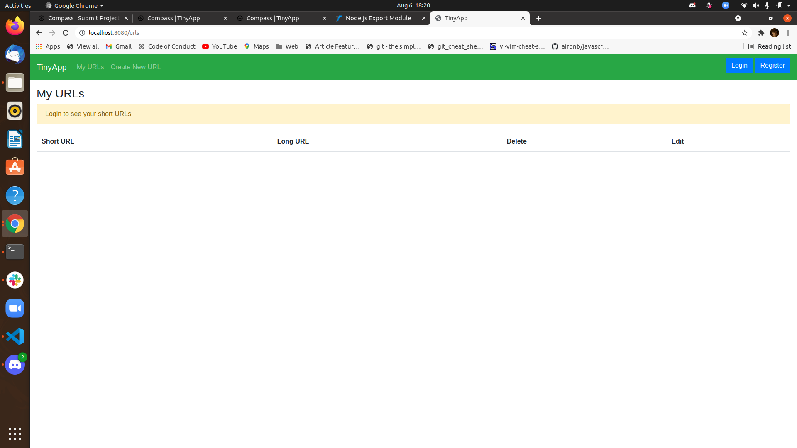
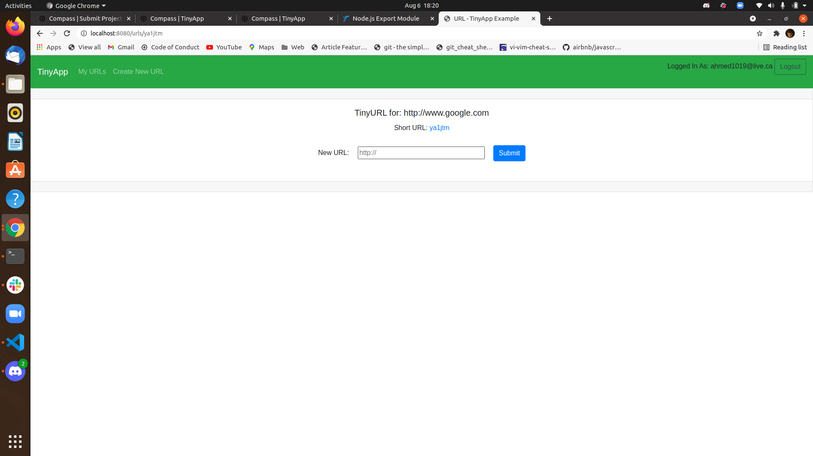

# TinyApp

**Node.js / Express URL shortener · Historical learning project**

A small full-stack application for registering an account, creating shortened URLs, and managing saved links. The server uses Express, EJS templates, and cookie-based sessions.

## Screenshots

| URL list | URL details |
| --- | --- |
|  |  |

## Tech

- Node.js and Express
- EJS server-rendered views
- Cookie sessions and bcrypt password hashing
- Mocha and Chai tests

## Setup

1. Install Node.js and npm.
2. Run `npm install`.
3. Start the development server with `npm start`.
4. Visit the local address reported by the server. Run tests with `npm test`.

This repository is an earlier full-stack programming exercise, **not a maintained production service**. It uses older dependencies and may require compatibility or security updates before reuse.

The screenshots are stored in `docs/`, so links do not depend on an old GitHub username.
